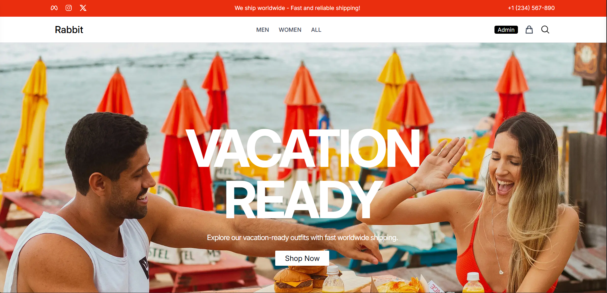
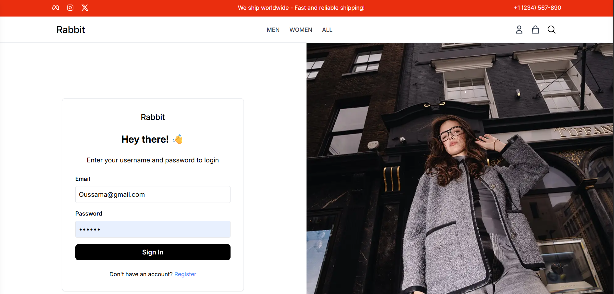
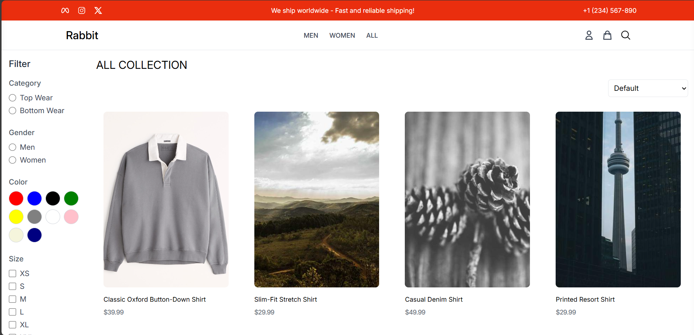
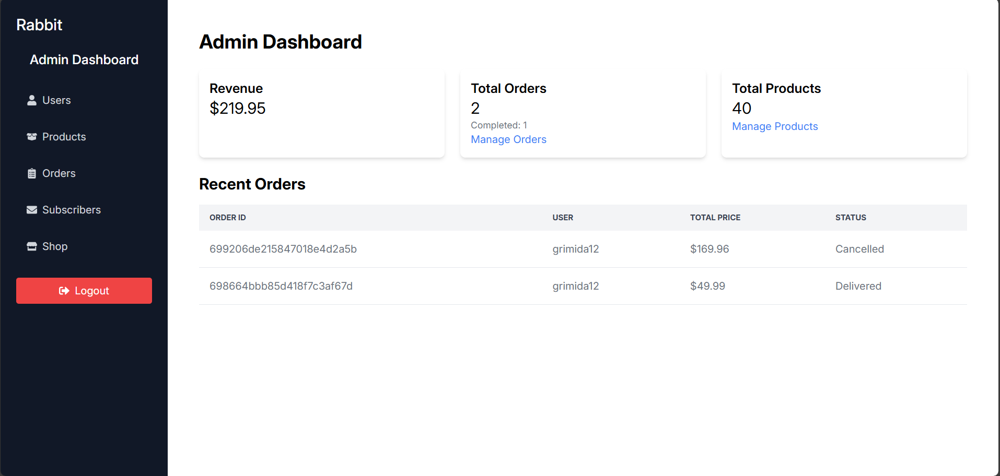
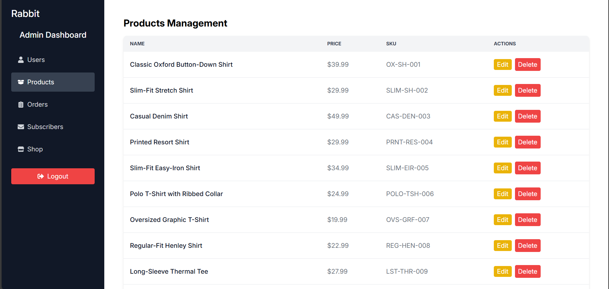
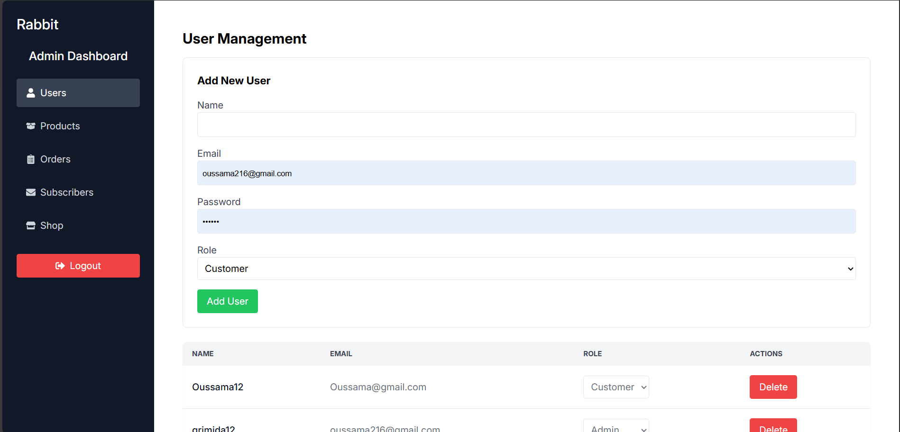

# Rabbit E-commerce

A full‑stack e‑commerce platform built with **React (Vite)**, **Redux Toolkit**, **Node/Express**, and **MongoDB**.  
Rabbit delivers a modern shopping experience with guest and authenticated carts, secure checkout, and a full admin dashboard for managing products, orders, users, and subscribers.

## Highlights

- Modern React UI with Vite and Tailwind‑style utility classes
- Redux Toolkit for predictable state and async data flows
- Guest and logged‑in carts with merge on login
- Checkout with PayPal or Cash on Delivery
- Admin dashboard for products, orders, users, and subscribers
- Cloudinary image uploads for product management

## Tech Stack

- **Frontend:** React 18, Vite, Redux Toolkit, React Router, Axios  
- **Backend:** Node.js, Express, Mongoose, JWT  
- **Storage:** MongoDB  
- **Payments:** PayPal (client integration)

## Project Structure

- `frontend/` — React app (Vite)
- `backend/` — Express API + MongoDB models

## Local Development

### Backend

```bash
cd backend
cp .env.example .env
# Edit .env: set MONGO_URI, JWT_SECRET, PORT
npm install
npm run dev
```

### Frontend

```bash
cd frontend
cp .env.example .env
# Edit .env: set VITE_BACKEND_URL, VITE_PAYPAL_CLIENT_ID (optional for checkout)
npm install
npm run dev
```

## Environment Variables

### Backend (`backend/.env`)

- `PORT` — API port
- `MONGO_URI` — MongoDB connection string
- `JWT_SECRET` — JWT signing secret
- `CLOUDINARY_CLOUD_NAME`, `CLOUDINARY_API_KEY`, `CLOUDINARY_API_SECRET` — image uploads
- `CORS_ORIGIN` — comma‑separated list of allowed frontend origins

### Frontend (`frontend/.env`)

- `VITE_BACKEND_URL` — backend API URL (no trailing slash)
- `VITE_PAYPAL_CLIENT_ID` — PayPal client ID

## Deployment Guide

1. **Environment**
   - Set production secrets (`MONGO_URI`, `JWT_SECRET`, Cloudinary keys).
   - Set `CORS_ORIGIN` to your deployed frontend domain(s).
   - Set frontend `VITE_BACKEND_URL` to the deployed API.

2. **Build**
   - `cd frontend && npm run build`
   - Host `frontend/dist` on your preferred static host (Vercel, Netlify, S3, etc.).

3. **Backend**
   - Run with `node server.js` or a process manager (PM2).
   - Ensure your host sets environment variables securely.

4. **Payments**
   - Use live PayPal credentials in production.
   - Always verify payment server‑side before marking orders as paid.

## Key Features

- Authentication: login, register, profile, protected routes
- Cart: guest + user carts with merge on login
- Checkout: PayPal and Cash on Delivery
- Orders: order history, order details, admin management
- Products: listing, filters, product detail, admin CRUD
- Admin: users, products, orders, subscribers
- Newsletter subscription

## Seed Data and Images

- The project includes a **seeder** with sample products.
- Seeded product images use external API URLs by default.
- You can upload and manage your own images via **Cloudinary** using the admin product editor.

## Security Notes

- Never commit `.env` files.
- Protect admin routes with JWT and `role === 'admin'`.
- Limit CORS to trusted domains in production.

## Screenshots

### Home Page (1)


### Home Page (2)


### Home Page (3)


### Login Page


### Shop Page


### Item Page


### Admin Dashboard (1)


### Admin Dashboard (2)


### Admin Dashboard (3)

